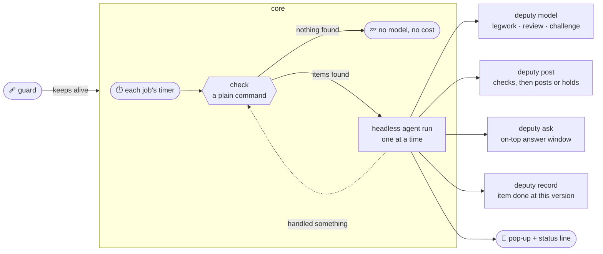

<div align="center">


[](#-quick-start)

[](#-quick-start)
[](#-start-it-at-logon)
[](#-safety)
[](package.json)
[](LICENSE)

[](https://github.com/suv0/deputy/actions/workflows/tests.yml)

**Cheap checks run on timers. When one finds work, a headless agent does it. The first built-in job reviews the pull requests you're asked to review.**



</div>

## ✨ Why deputy

<table>
<tr>
<td width="33%" valign="top">

### 💤 Free while idle
A check is a plain command: ask GitHub, a CI system, a queue. **No model runs until a check finds work.**

</td>
<td width="33%" valign="top">

### 👀 Reviews for you
When someone requests your review, cheap models gather the facts, a strong one drafts the review, a second one **tries to prove it wrong**, and every claim is checked in the code.

</td>
<td width="33%" valign="top">

### ⚖️ Judges you trust
Legwork runs on any tool, cheapest first. **Verdicts come only from the tools you trust** (Codex and Claude by default). A model out of limit never stops the work.

</td>
</tr>
<tr>
<td valign="top">

### 🛡️ Rules in code, not in a prompt
Moved head, comment outside the diff, a long paragraph, a dash, an untagged name, important work without a challenge: **`deputy post` refuses it.** New installs only draft.

</td>
<td valign="top">

### 🩹 Heals itself
A guard restarts the core after a crash. Failed runs back off. A dead run never blocks the next. **New code loads by itself** between runs.

</td>
<td valign="top">

### 🔔 Reaches you
An on-top pop-up with a chime, a colored status line above your Claude Code prompt, and an **answer window** for the rare question a run can't settle.

</td>
</tr>
</table>

## 🚀 Quick start

```bash
git clone https://github.com/suv0/deputy.git
cd deputy
node bin/deputy.mjs demo
```

The demo runs a whole review against a fake GitHub with scripted models, so it needs no login and no model. It
uses deputy's real watcher, filters, diff-anchor check, posting checks and verdict rules.

Then set it up for real:

```bash
npm link                 # puts `deputy` on your PATH (or use node bin/deputy.mjs)
deputy init              # writes ~/.deputy/config.json
```

Set `github.login` and `repos` in that file, then:

```bash
deputy doctor                  # checks gh, the agent CLIs and the config
deputy review acme/shop 42     # review one open PR now, as a try
deputy held                    # read what it drafted
```

When the drafts look right, run it in the background ([at logon](#-start-it-at-logon)) and, if you want, turn on
`"posting": "auto"`.

<details>
<summary><b>Requirements</b></summary>

<br>

- Node.js 20 or newer. No npm packages.
- The [GitHub CLI](https://cli.github.com/), logged in as you (`gh auth login`).
- [Claude Code](https://docs.anthropic.com/en/docs/claude-code) (`claude`) to drive each run. Any other headless agent
  CLI that reads a prompt on stdin works too: set `driver`.
- At least one model tool for the tiers. The default config uses only `claude`. Add
  [Codex](https://developers.openai.com/codex/cli), [Command Code](https://commandcode.ai/) or
  [opencode](https://opencode.ai/) to spread the work and the cost.

</details>

## 🔄 How it works



1. **Jobs.** Each job has a check, a timer and a prompt. The check prints the items that need work as JSON.
2. **One run at a time.** When a check finds items, the core starts one headless agent run with the job's prompt and
   those items, and waits for it.
3. **Done means done at a version.** The run calls `deputy record <job> <id> <version>`. The item comes back only when
   its version changes: a PR's new head, a CI run's new attempt, an issue's new update time.
4. **A good run** is one that handled at least one of its items. The same check runs again at once, so work that
   arrived meanwhile isn't left for a cycle. **A run that handled nothing failed**, whatever its exit code.

### 🩹 Self-healing

| What goes wrong | What deputy does |
| --- | --- |
| The core crashes | The guard starts it again after 30 s, then 1, 2 and 4 minutes, at most every 5 minutes |
| A run keeps failing | That job waits longer each time: 5, 10, 20, 40, then 60 minutes |
| A run dies (killed, crash, restart) | The lock names the run's process, so a dead run never blocks the next one |
| A run hangs | It is stopped after 2 hours (`runLimitMinutes`) |
| deputy's code changes | The core finishes its run, exits, and the guard starts the new code at once |
| A check keeps failing | A pop-up after three failures in a row; the status line says which job |

## 👀 The PR review job

Built in, and on by default. It finds open, non-draft PRs where you (or one of your `github.teams`) are a requested
reviewer. GitHub drops you from that list once you review, and adds you back when the author asks again, so the list
is the queue.

For each PR, the run:

| Step | Who | What |
| --- | --- | --- |
| Prepare | `deputy prepare` | A fresh checkout, and the GitHub facts in a file: threads, checks, failing logs, overlapping PRs |
| Legwork | `legwork` tier | The diff, what each changed thing touches, the code behind each failing check |
| Review | `review` tier | A draft against [the checklist](checklist/review-checklist.md), as a GitHub review payload |
| Challenge | `challenge` tier | For important work: tries to disprove each blocker, or to find what the review missed |
| Check | the run itself | Opens the file and line behind every claim it keeps; drops what it can't prove |
| Post | `deputy post` | The posting checks below, then posts or holds |

**Important work** is money, login, permissions, secrets, personal data, migrations, deploys, or any draft that
holds or blocks a merge. Set what counts in `important.topics` and `important.paths`.

**Verdicts** follow one rule: approve by default. A fix that must land first rides on the approval as a red
`> [!CAUTION]` that starts "Do not merge until…". A real but non-blocking risk is a yellow `> [!WARNING]`.
`REQUEST_CHANGES` is for a proven serious break, and only once the challenge failed to disprove it. Every verdict
goes to `deputy post`; nothing is held back unless your config says so.

**Re-reviews** look only at what changed since your last review, check each of your earlier comments in the code,
and reply in those threads.

### 🛡️ The posting checks

`deputy post` runs these on every review, in code, before anything reaches GitHub:

- the PR head hasn't moved since the review;
- every inline comment sits inside GitHub's own diff, and every thread reply answers a top-level comment;
- important work has a challenge on file;
- the text reads like a teammate typed it: no em or en dashes, paragraphs of at most 3 sentences or 350
  characters, and every team member named by their @login (an optional honorific may follow only that person's tag,
  like `@sam ji`);
- the docs haven't moved since the review read them (when `refreshDocs` is on);
- the verdict rules (`verdict.requestChanges`, `verdict.approveEvent`).

A problem means nothing is posted, and the run fixes the review and tries again.

Make it yours with `context` and `style`: your own checklist, your team file and logins, your architecture docs,
and a voice file for how the reviews should sound. [examples/](examples) has neutral starting points.

## 🧩 Your own jobs

A job is a check and a prompt. The check is any command that prints a JSON list:

```json
[{ "id": "acme/shop#42", "version": "4f1c2a9", "title": "shop #42 CI" }]
```

`id` names the item, `version` says when it needs work again, `title` is what the pop-up and status show. Anything
else you add is passed to the run.

```json
"jobs": [
  { "name": "pr-review", "builtin": "pr-review", "everyMinutes": 5 },
  { "name": "failing-ci", "everyMinutes": 15,
    "check": ["node", "examples/jobs/failing-ci/check.mjs", "acme/shop"],
    "prompt": "examples/jobs/failing-ci/prompt.md" }
]
```

The prompt file is a template: `{{ITEMS_JSON}}`, `{{JOB}}`, `{{DEPUTY}}` (how to call deputy), `{{LOGIN}}`, `{{STATE}}`,
and any `vars` you set on the job. `deputy check <job>` runs a check on its own, so you can see what it finds before
any model runs.

Two examples ship in [examples/jobs](examples/jobs): **failing-ci** (why your PRs' CI fails, and whether the base
branch fails too) and **assigned-issues** (a short brief for each issue assigned to you that changed).

## 🔀 Models

`deputy model --tier <legwork|review|challenge>` runs one task on the first model of a tier that answers:

```json
"models": {
  "judges": ["codex", "claude"],
  "tiers": {
    "legwork":   [{ "tool": "command-code", "model": "…" }, { "tool": "codex", "model": "…" }, { "tool": "opencode", "model": "openrouter/…" }],
    "review":    [{ "tool": "codex", "model": "…", "effort": "high" }],
    "challenge": [{ "tool": "codex", "model": "…", "effort": "xhigh" }]
  }
}
```

- **Legwork runs anywhere**, cheapest first. Paid-per-token tools like OpenRouter go last.
- **Judging runs only on `judges`.** The review and the challenge decide verdicts, so they run only on the tools you
  trust. `deputy doctor` flags a judging tier that names any other tool.
- **A limit never stops the work.** A tool that says its account is out of limit or credit is skipped, for every
  model on it, until its reset time (or 15 minutes). When no judge is left, `deputy model` exits with code 3 and the
  run does that stage itself.
- **opencode** gets permission to read outside its folder (`OPENCODE_CONFIG_CONTENT`), so it can read the run's
  files and the docs.
- **Read only** by default. `deputy usage --since 24h --line` gives one line of what the models did.

[examples/models.mixed.json](examples/models.mixed.json) mixes four tools.

## 🔔 Status, pop-ups and the answer window

```bash
deputy status            # every job: last check, what it found, failed runs, the current run's stage
deputy status --line     # one line for a status bar or prompt
deputy status --json     # the line, its color, and a link for every PR it names
```

```text
deputy: pr-review running for shop #42 (let coupons stack checkout): review model is reviewing
deputy: idle, checked 2m ago · last: shop #42 (let coupons stack checkout) at 14:05
deputy: last run failed, retrying pr-review at 14:40
deputy: PAUSED, 2 waiting (on holiday). deputy resume starts runs again
deputy: restarting (the guard brings it back)
deputy: STUCK (pr-review last checked 20m ago)
```

Every number comes with a few words of what it is. `deputy pause` stops new runs while the checks go on.

**In Claude Code**, [integrations/claude-code-status](integrations/claude-code-status) is a mod that shows that line
above your prompt, refreshed every 30 seconds: green when healthy, yellow while running or retrying, red when stopped
or stuck, with every PR number a button that opens it on GitHub (the desktop app draws links in that band as plain text, so they are buttons).

**Pop-ups** come when a run finishes (with the last lines of its own summary), when a review is held for you, and
when runs or checks keep failing. Windows plays a chime and shows an on-top pop-up that closes itself after a minute;
macOS uses Notification Center; Linux uses `notify-send`.

**The answer window** is for the rare question a run can't settle from the rules, the code and the docs:

```bash
deputy ask "acme/shop #42: two docs disagree on the refund limit. Follow the newer one?"
# {"answer":"yes"} | {"answer":"no"} | {"answer":"text","text":"…"} | {"answer":"none"}
```

On Windows it stays on top, plays an alarm when it opens, sounds and flashes again every 2 minutes, and closes after
10 with `none`, so the run takes the safer choice. Sounds come from Windows' own sound files, so they play even with
the system sound scheme switched off. macOS uses a dialog that gives up after the same time; Linux uses `zenity`.

## 🛡️ Safety

- **New installs only draft.** With `"posting": "draft"` every review is held in `~/.deputy/held/`. Read them with
  `deputy held`, then `deputy held post <k>`, `soften <k>` or `drop <k>`. Posting a held review needs you at a
  terminal, never a run.
- **What it posts:** one review per PR (its body, inline comments, and a verdict), plus short replies in your earlier
  threads on a re-review. Nothing else. Every post passes [the posting checks](#-the-posting-checks) first.
- **REQUEST_CHANGES** is allowed only after a challenge on file. Set `verdict.requestChanges` to `"soften"` or
  `"hold"` if you'd rather never block a merge from deputy.
- **The driver has a shell.** Claude Code runs with `Bash` allowed, so a run could call `gh` itself. The prompt tells
  it never to, and deputy can't enforce that. If that matters to you, narrow `driver.args` (for example
  `--allowedTools "Bash(node:*)" "Bash(git:*)" Read Write Edit Glob Grep`), or give the run a GitHub token that can
  only read.
- **Stop it** with Ctrl+C, `scripts/uninstall-windows.ps1`, `systemctl --user stop deputy` or `launchctl unload`.
  `deputy pause` stops new runs without stopping it; `"posting": "draft"` stops posting at the next review.
- **Your models, your accounts.** deputy calls the CLIs you have installed and logged in. It has no server, no
  telemetry and no keys of its own.

## ⏱️ Start it at logon

`deputy start` runs the guard, which runs the core. Start that at logon:

**Windows.** A per-user scheduled task, no admin, no console window:

```powershell
powershell -ExecutionPolicy Bypass -File scripts\install-windows.ps1
```

`scripts\uninstall-windows.ps1` stops the guard and the core and removes the task. Your config and state stay in
`%USERPROFILE%\.deputy`.

**macOS.** Edit the paths in [scripts/dev.deputy.watcher.plist](scripts/dev.deputy.watcher.plist), copy it to
`~/Library/LaunchAgents/`, then `launchctl load` it.

**Linux.** Edit the path in [scripts/deputy.service](scripts/deputy.service), copy it to `~/.config/systemd/user/`,
then `systemctl --user enable --now deputy`.

## ⚙️ Config reference

`deputy init` writes a starter file. deputy looks for `--config <file>`, then `$DEPUTY_CONFIG`, then
`./deputy.config.json`, then `~/.deputy/config.json`. Relative paths are read from the config file's folder.

| Setting | Default | What it does |
| --- | --- | --- |
| `jobs` | the PR job | Each `{ name, builtin \| check + prompt, everyMinutes, maxItemsPerRun, enabled, vars, driver }` |
| `github.login`, `github.teams` | | Whose review requests the PR job follows |
| `repos` | | `owner/name` repos the PR job watches |
| `posting` | `"draft"` | `"auto"` posts reviews that pass every check |
| `verdict.approveEvent` | `"APPROVE"` | `"COMMENT"` if bot approvals shouldn't count |
| `verdict.requestChanges` | `"allow"` | Allowed after a challenge; `"soften"` or `"hold"` instead |
| `requireChallenge` | `true` | Important work can't leave without a challenge on file |
| `style` | on | `noDashes`, `maxSentences` (3), `maxParagraphChars` (350), `team` (name to login, optional honorific) |
| `skipApprovedByOthers` | `true` | Skip a PR someone else already approved at this head |
| `maxPrsPerRun` | `4` | PRs per run; the rest go in the next run |
| `important.topics`, `.paths` | money, login, … | What gets the challenge tier |
| `context.checklist` | built-in | Your review checklist |
| `context.teamFile`, `.voiceFile` | | Who owns what; how reviews should sound |
| `context.docsDir`, `.refreshDocs` | | Docs to review against; `refreshDocs` resets that folder to its remote tip each run |
| `context.extraInstructions` | | One more rule for every review |
| `checkouts.root`, `.clones` | `~/deputy-checkouts` | Where PR checkouts go; reuse existing clones per repo |
| `driver` | `claude -p …` | The headless agent each run uses |
| `models.tiers`, `.tools`, `.judges` | Claude only | Models per tier, the command for each tool, who may judge |
| `pollMinutes` | `5` | Default timer for jobs without `everyMinutes` |
| `runLimitMinutes` | `120` | A run that takes longer is stopped |
| `notify` | `true` | Pop-ups on or off |
| `ask.minutes`, `.remindEveryMinutes` | `10`, `2` | The answer window's timing |
| `stateDir` | `~/.deputy` | Status, logs, runs, held reviews (or `$DEPUTY_HOME`) |

## 🧰 Commands

| Command | |
| --- | --- |
| `deputy demo [--fast] [--draft] [--no-popup]` | One whole review with no GitHub and no model |
| `deputy init` / `doctor` | Starter config; check everything is in place |
| `deputy start` | The guard and the core: run the jobs, heal crashes, load new code |
| `deputy once` | Check each job once, and run the ones with work |
| `deputy review <owner/repo> <n>` | Review one PR now, whoever it requests; posting rules still apply |
| `deputy pause [reason]` / `resume` | Stop or allow new runs; the checks go on |
| `deputy status [--line\|--json]` | Running, idle, retrying, paused, restarting, stuck or stopped |
| `deputy jobs` / `check <job>` | List jobs; run one check and print what it finds |
| `deputy held [post\|soften\|drop <k>]` | Reviews waiting for you |
| `deputy pending` | The PRs that wait on your review, as JSON |
| `deputy prepare` / `cleanup <owner/repo> <n>` | A run's fresh PR checkout, GitHub facts and run folder |
| `deputy model --tier <t> --prompt-file <f>` | One task on the next available model |
| `deputy post <review.json> [--post]` | The posting checks; then post or hold |
| `deputy record <job> <id> <version> [outcome]` | Mark an item done at this version |
| `deputy ask "<question>"` / `notify "<title>" "<body>"` | The answer window; a pop-up |
| `deputy open <https url>` | Open a link in the browser, on any OS |
| `deputy usage [--since 24h] [--line]` | What the models did |

<details>
<summary><b>The code</b></summary>

<br>

| File | Job |
| --- | --- |
| `bin/deputy.mjs` | The commands |
| `src/guard.mjs` | Keeps the core alive: restarts after a crash with backoff, at once after a reload |
| `src/watcher.mjs` | The core: timers, one run at a time, failed-run backoff, the pid lock, self-reload |
| `src/jobs.mjs` | Jobs: the built-in PR job and command jobs; done-at-a-version |
| `src/pending.mjs` | Which PRs wait on your review |
| `src/post.mjs` | The posting checks; posts, holds or refuses a review |
| `src/style.mjs` | The text checks: dashes, paragraph length, untagged names |
| `src/anchors.mjs` | Inline comments against GitHub's diff hunks |
| `src/verdict.mjs` | The verdict rules |
| `src/models.mjs` | Tiers, judges, fallback, out-of-limit memory, usage log |
| `src/status.mjs` | The status line, its color and links, and the report |
| `src/notify.mjs`, `src/ask.mjs` | Pop-ups and the answer window, per OS |
| `src/checkout.mjs` | PR checkouts, GitHub facts, the done record |
| `prompts/` | The PR review run's prompt and the reviewer's rules |
| `checklist/` | The default review checklist |
| `integrations/claude-code-status/` | The Claude Code status line mod |

`npm test` runs the tests (Node's own runner, no packages). CI runs them on Windows, macOS and Linux with Node 20 and
22, plus the demo.

</details>

## 📄 License

MIT. See [LICENSE](LICENSE).

<div align="center">


</div>
